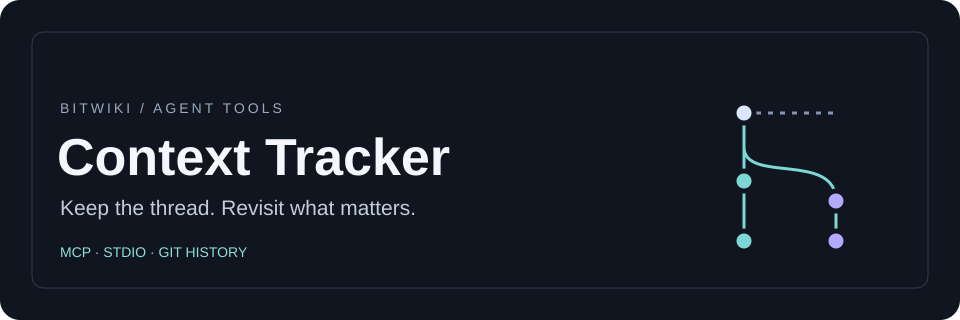
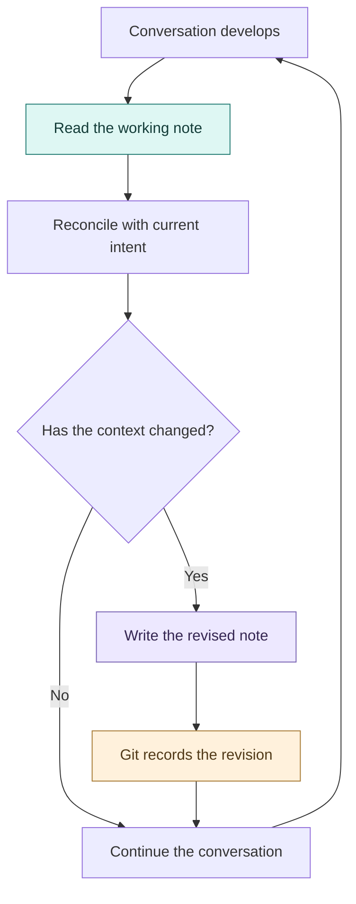
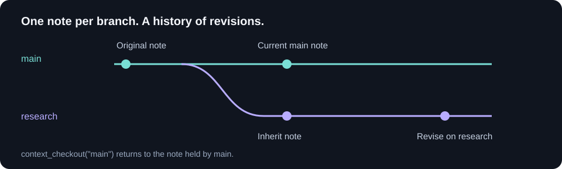

<div align="center">

<a id="context-tracker"></a>


**One working note. Seven MCP tools. A thread you can return to.**

[Get started](#quick-start) · [How it works](#the-context-loop) · [Tools](#mcp-tools) · [Branches](#branches-and-storage)

</div>

---

Context Tracker gives an AI agent a place to keep unfinished tasks, open questions, and clues it wants to revisit later in a conversation. It exposes a small working note through the **Model Context Protocol (MCP)** and records revisions in Git.

| Keep in view | Revisit later | Follow a thread |
| :--- | :--- | :--- |
| The current goal and its constraints | Questions, reminders, and unresolved decisions | Branch the note and return to an earlier line of work |

<details>
<summary><strong>Explore the documentation</strong></summary>

- [The context loop](#the-context-loop)
- [Quick start](#quick-start)
- [Session workflow](#session-workflow)
- [MCP tools](#mcp-tools)
- [Branches and storage](#branches-and-storage)
- [FAQ](#faq)
- [Repository map](#repository-map)

</details>

## The context loop

The agent writes what matters, retrieves it when relevant, and revises it as the conversation develops. This repeated use is intended to support continuity of attention and consistency across a long session.



| Note field | Capacity | Purpose |
| :--- | ---: | :--- |
| `title` | 120 characters | Name the active context |
| `content` | 500 characters | Carry the information worth revisiting |

The content is free text. A compact to-do list, an unresolved question, or a reminder about the user's stated preferences can all fit the same note.

<p align="right"><a href="#context-tracker">↑ Back to top</a></p>

---

## Quick start

You’ll need Python 3.10 or newer, Git 2.28 or newer, and an MCP client that supports stdio.

```sh
git clone https://github.com/bitwikiorg/context_tracker.git
cd context_tracker
python3 -m venv .venv
.venv/bin/python -m pip install -r requirements.txt
```

Configure your MCP client to launch `server.py` over stdio. For clients that use an `mcpServers` configuration, replace `/absolute/path/to/context_tracker` with the path to your clone.

```json
{
  "mcpServers": {
    "context-tracker": {
      "command": "/absolute/path/to/context_tracker/.venv/bin/python",
      "args": ["/absolute/path/to/context_tracker/server.py"],
      "env": {
        "CONTEXT_TRACKER_HOME": "/absolute/path/to/context-tracker-state"
      }
    }
  }
}
```

Choose a fresh directory for `CONTEXT_TRACKER_HOME` and call `context_read`. The response is JSON text with `status: EMPTY`, branch `main`, and blank title and content.


<p align="right"><a href="#context-tracker">↑ Back to top</a></p>

---

## Session workflow

1. **Start a conversation.** Use `context_write` to set its working note. If you’re resuming the same conversation, read the existing note first.
2. **Revisit it when it matters.** Call `context_read` when an earlier question, constraint, or task becomes relevant. Treat the note as context for the current request.
3. **Edit or replace the note.** Call `context_write` again with the full title and content you want to keep. To edit just one field, pass the other field unchanged. When the current context is resolved, write the next context into the same note. Git records the previous revision.

For example, call `context_write` with these arguments.

```json
{
  "title": "README review",
  "content": "Open question: does the setup example show where the Git state lives?"
}
```

Call `context_read` to retrieve the note. Its status is now `ACTIVE`.

> [!IMPORTANT]
> The agent or host decides when to call the tools. Starting a conversation leaves the stored note in place. Initialize the note for each new conversation, or give each conversation its own state directory when your client can set one.


<p align="right"><a href="#context-tracker">↑ Back to top</a></p>

---

## MCP tools

| Tool | Arguments | Behavior |
| --- | --- | --- |
| `context_read` | None | Return the current note, branch, and `EMPTY` or `ACTIVE` status as JSON text. |
| `context_write` | `title`, `content` | Replace the note and return JSON text. An identical write returns `changed: false` and skips the commit. |
| `context_branches` | None | List local branches and identify the current branch. |
| `context_branch` | `name` | Create and switch to a branch that inherits the current note. |
| `context_checkout` | `name` | Switch to an existing branch and return its note. |
| `context_tree` | None | List tracked paths on the current branch. |
| `context_history` | `limit` (optional) | List recent commits for the note. Default 10, range 1–50. |


<details>
<summary><strong>Response format and write behavior</strong></summary>

`context_read` and `context_write` return explicit JSON text. The other five tools return structured objects.

A successful changed write returns `changed: true`, a short commit identifier, and the current note state. An identical write returns `changed: false`. Nonblank content requires a nonblank title.

```json
{
  "status": "ACTIVE",
  "branch": "main",
  "title": "README review",
  "content": "Open question: does the setup example show where the Git state lives?"
}
```

</details>

<p align="right"><a href="#context-tracker">↑ Back to top</a></p>

---

## Branches and storage



`context_branch` creates a branch and switches to it, inheriting the current note. Subsequent writes belong to the selected branch. Use `context_checkout` to return to an existing branch.

| Storage property | Behavior |
| :--- | :--- |
| Default location | `~/.local/state/context-tracker-mcp` |
| Custom location | Set `CONTEXT_TRACKER_HOME` in the server environment |
| Tracked note | `notes/current.json` |
| Initial branch | `main` |
| History | Git commits retain earlier revisions |
| Concurrent conversations | Use separate state directories for independent notes and branch selection |

The server initializes the Git repository on first use. All processes using the same directory share its current note and checked-out branch. Session initialization and tool invocation are responsibilities of the agent or host.

<p align="right"><a href="#context-tracker">↑ Back to top</a></p>

---

## FAQ

<details>
<summary><strong>Does the note survive a server restart?</strong></summary>

Yes. Git and the note remain on disk. The intended workflow establishes the appropriate context for each conversation. The host or agent controls when that happens.

</details>

<details>
<summary><strong>How do I clear the note?</strong></summary>

Call `context_write` with an empty title and empty content.

```json
{"title": "", "content": ""}
```

The current state becomes `EMPTY`. Previous revisions remain in Git history.

</details>

<details>
<summary><strong>What can the file tree show?</strong></summary>

`context_tree` lists tracked paths on the selected branch. The current server manages one note at `notes/current.json`.

</details>

<p align="right"><a href="#context-tracker">↑ Back to top</a></p>

---

## Repository map

| File | Role |
| :--- | :--- |
| [server.py](server.py) | MCP tools, note validation, and Git operations |
| [requirements.txt](requirements.txt) | Pinned MCP dependency |
| [assets/hero-banner.svg](assets/hero-banner.svg) | Project banner |
| [assets/branches.svg](assets/branches.svg) | Note branching diagram |

<p align="right"><a href="#context-tracker">↑ Back to top</a></p>
